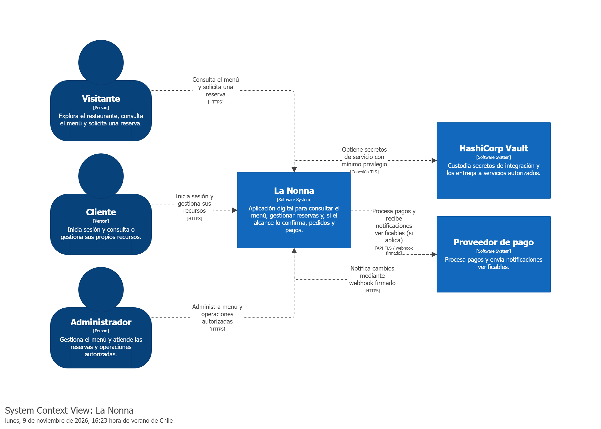
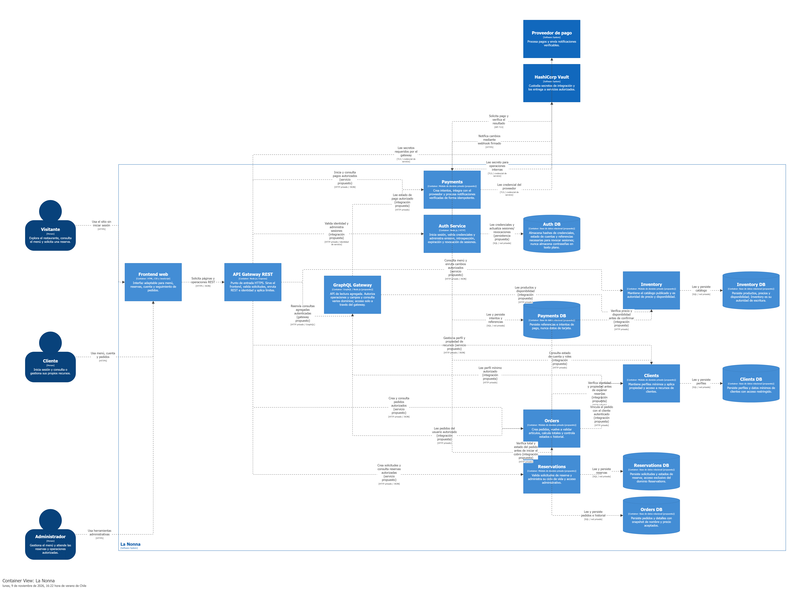
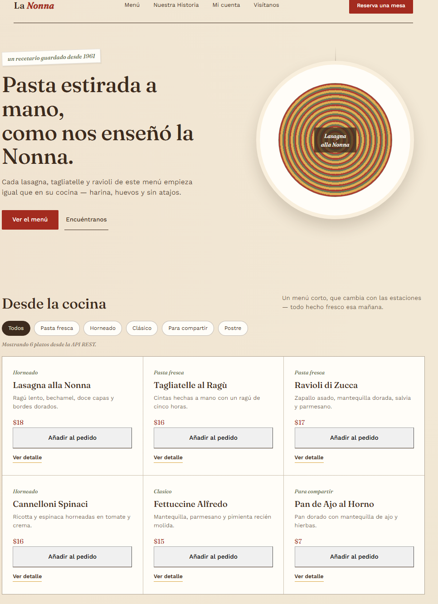
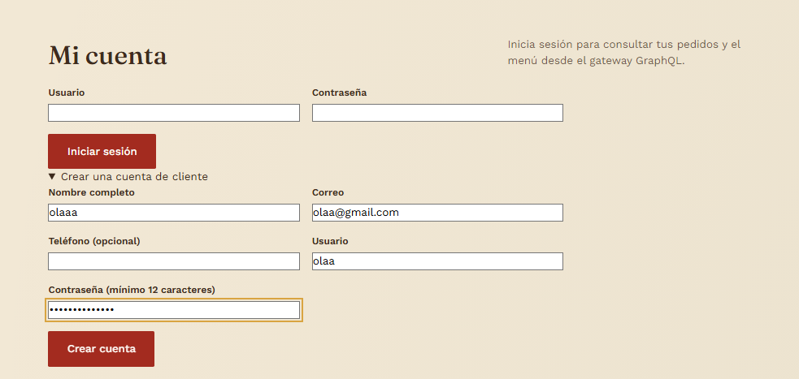
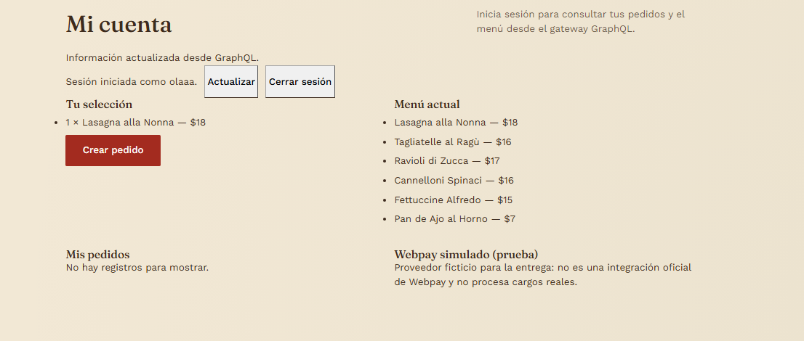
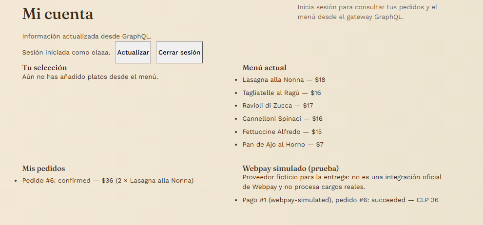

# Informe de trabajo — Entrega 2

## Diseño e implementación de un backend seguro para La Nonna

| Antecedente | Información |
|---|---|
| Asignatura / evaluación | Unidad 2 — Diseño e implementación de un backend seguro completo |
| Caso de negocio | La Nonna |
| Integrantes | Benjamin Reyes; Rodrigo Tennenbaum |
| Identificador oficial del caso | 33 |
| Versión del frontend | Versión de entrega al cierre; no existe número/tag formal y el frontend se modificó en varias iteraciones |
| Fecha indicada en la guía | 9 de noviembre de 2026 |
| Estado de este informe | Código, pruebas, limitaciones y evidencia disponibles al 9 de noviembre de 2026 |

> Este documento informa el trabajo realizado frente a la guía. No sustituye la evaluación del docente ni afirma una calificación garantizada. Las capacidades no implementadas o no ejecutadas se declaran como pendientes.

## 1. Resumen ejecutivo

Se conectó el frontend de La Nonna a servicios Node.js/Express con persistencia SQLite. Se añadieron procesos independientes para `auth`, `clients`, `inventory`, `orders`, `payments` y `reservations`, un API Gateway REST con rutas permitidas/rate limit/validación de sesión y un GraphQL Gateway privado. Cada dominio transaccional tiene archivo SQLite propio; las colaboraciones son HTTP interno y no consultas a bases ajenas. El pago permanece como **Webpay simulado** (proveedor ficticio, sin integración oficial ni cargos reales), ahora con webhook HMAC, ventana temporal y deduplicación de eventos.

La verificación disponible incluye una prueba integrada que levanta ocho procesos independientes y pruebas HTTP de contratos, autorización, tokens internos, firma/deduplicación del webhook y compra. Compose incorpora Vault para guardar los secretos de runtime: un inicializador crea secretos aleatorios y políticas de lectura por servicio; cada proceso obtiene únicamente su token de Vault y lee su propio secreto antes de arrancar. La topología levantó ocho servicios saludables, solo Gateway publicó el puerto 4000 y se completó el flujo de cliente/pedido/pago/GraphQL. Vault corre en modo dev para una demostración local reproducible, sin persistencia ni TLS; no debe usarse así en producción. Docker compila SQLite desde fuente para evitar incompatibilidad de glibc. Se incluyen capturas de la interfaz y diagramas C4 como evidencia visual; para producción, Vault requiere configuración persistente y segura.

## 2. Alcance, supuestos y decisiones

El trabajo cubre los flujos que existen en la interfaz y las operaciones requeridas por la guía:

- Consulta pública del menú y solicitud validada de reserva.
- Registro de clientes, inicio/cierre de sesión y consulta/actualización del perfil propio.
- Creación y consulta de pedidos autenticados.
- Administración de productos e inventario, con registro de movimientos.
- Pago simulado, idempotente y limitado al propietario del pedido.
- Consulta agregada GraphQL del menú y pedidos.

**Supuestos de implementación:** los pedidos requieren sesión; Webpay es un proveedor ficticio para la evaluación, no una API/sandbox oficial; Vault dev se limita a la ejecución local de Compose; la compra como invitado no forma parte del flujo. La API monolítica anterior se conserva para compatibilidad/pruebas históricas; la topología de despliegue objetivo se inicia con `src/microservices/server.js` mediante Compose, no con el servidor legado `server.js`. El proyecto anterior `Codigo/auth-service` no se inicia en esta topología; el servicio activo de autenticación es `auth` dentro de Compose.

## 3. Trazabilidad de pantallas, operaciones y contratos

| ID | Pantalla / evento | Operación | Acceso y regla aplicada | Estado |
|---|---|---|---|---|
| S01 | Abrir o filtrar menú | `GET /api/productos?categoria=&limit=` | Público; lectura del catálogo persistido. | Implementado |
| S02 | Ver detalle del plato | `GET /api/productos/:id` | Público. | Implementado |
| S03 | Enviar reserva | `POST /api/reservas` | Público con validación de campos y persistencia. | Implementado |
| S04 | Administrar reservas | `GET /api/reservas`, `PATCH /api/reservas/:id/status` | Requiere sesión y rol administrador. | Implementado |
| S05 | Iniciar/cerrar sesión | `POST /api/login`, `GET /api/me`, `POST /api/logout` | Sesión expirable y revocable; token enviado como Bearer. | Implementado |
| S06 | Registrar cliente | `POST /api/clients/register` | Registro público; crea usuario, perfil y sesión. | Implementado |
| S07 | Consultar/actualizar perfil | `GET/PATCH /api/clients/me` | Requiere sesión; solo modifica el perfil asociado al usuario. | Implementado |
| S08 | Añadir plato y crear pedido | `POST /api/orders` | Requiere cliente autenticado. Orders pide a Inventory reservar el stock atómicamente y usa su snapshot autoritativo de precio/nombre. | Implementado mediante HTTP interno y compensación |
| S09 | Consultar pedido | `GET /api/orders`, `GET /api/orders/:id` | Propietario del pedido; administrador según permisos de la ruta. | Implementado |
| S10 | Administrar productos y stock | `/api/inventory/products`, `/api/inventory/products/:id/stock`, `/api/inventory/movements` | Requiere rol administrador; cada variación se valida y registra. | Implementado |
| S11 | Pagar pedido | `POST /api/payments` | Dueño del pedido; requiere `Idempotency-Key`. Payments consulta Orders por HTTP interno; aviso HMAC y `event_id` único. | Implementado con Webpay ficticio/simulado; sin integración oficial |
| S12 | Consultar pagos | `GET /api/payments`, `GET /api/payments/:id` | Propietario o administrador; no devuelve la clave idempotente. | Implementado |
| S13 | Cambiar estado/cancelar pedido | `PATCH /api/orders/:id/status` | Requiere administrador; valida transición. Cancelar repone stock y marca el pago de prueba como reembolsado. | Implementado |
| S14 | Panel agregado de cuenta | `POST /api/graphql` con `dashboard` | Menú público; pedidos requieren sesión y respetan pertenencia. | Implementado y conectado a “Mi cuenta” |
| S15 | Estado y diagnóstico | `GET /health`, `GET /api/health`, `GET /api/metrics` | Health interno por proceso/SQLite; health público del Gateway; métricas requieren rol administrador. | Implementado |
| S16 | Aviso del proveedor | `POST /api/payments/webhooks/webpay` | Firma HMAC-SHA256 sobre timestamp + body original, ventana de 300 segundos, `event_id` único y hash de payload. | Implementado y probado localmente; Webpay no es proveedor real |

Los contratos completos y ejemplos de solicitudes están en el [README técnico de la API](Codigo/api-la-nonna/README.md). La trazabilidad anterior cubre los flujos implementados; debe cotejarse con la versión final de las pantallas y con el número de caso que confirme el equipo.

## 4. Arquitectura y límites de los sistemas

### 4.1 Estructura implementada

| Dominio / componente | Responsabilidad | Persistencia y frontera |
|---|---|---|
| `gateway` | Allowlist REST, rate limit, autenticación/rol, firma de identidad verificada y entrega frontend. | Proceso público único; sin base de datos. |
| `auth` | Credenciales, sesiones con expiración/revocación, bootstrap de administrador e introspección interna. | `auth_data`; usuarios/sesiones. |
| `clients` | Registro coordinado con Auth y administración del perfil propio. | `clients_data`; solo datos de perfil. |
| `inventory` | Catálogo, stock, reserva/liberación idempotente y libro de movimientos. | `inventory_data`; productos/movimientos/reservas. |
| `orders` | Pedidos, snapshots de nombre/precio, propiedad y transiciones. | `orders_data`; pedidos y líneas, sin acceso a SQLite de Inventory. |
| `payments` | Pago simulado, idempotencia de operación, verificación HMAC y deduplicación de eventos. | `payments_data`; pagos/eventos, sin acceso a SQLite de Orders. |
| `reservations` | Solicitudes y administración de reservas. | `reservations_data`; reservas. |
| `graphql` | Composición privada de menú y pedidos vía HTTP interno. | Proceso sin base de datos; no accede directamente a almacenamiento ajeno. |

Compose configura ocho procesos/servicios (incluido GraphQL), una red privada `internal`, una red `edge` solo compartida con Gateway, volúmenes separados y un único `ports` para Gateway. La configuración se construyó y ejecutó; todos los health checks pasaron y el host solo alcanzó Gateway. El modelo editable y diagramas están en [Diagramas](Diagramas/), incluyendo [modelo de dominio](Diagramas/modelo-dominio.puml), [gateway y seguridad](Diagramas/gateway-y-seguridad.puml) y [despliegue](Diagramas/despliegue.puml).

#### Diagramas de arquitectura (C4)

El diagrama de contexto resume actores y sistemas externos; el de contenedores detalla los procesos, sus bases y las integraciones privadas. Las imágenes se presentan aquí para lectura rápida y sus fuentes editables están en [Diagramas](Diagramas/).



*Figura 1. Contexto de La Nonna, actores, Vault y proveedor de pago simulado.*



*Figura 2. Contenedores, servicios, bases de datos y comunicaciones internas.*

### 4.2 Reglas de negocio relevantes

1. El servidor calcula el total con los precios vigentes en la base; no acepta un importe enviado por el navegador.
2. Inventory reserva varias líneas en una transacción local y devuelve snapshot de precios/nombres; Orders persiste el pedido por separado. Si falla la persistencia, Orders compensa liberando la reserva. No es una transacción distribuida ACID.
3. Las líneas guardan nombre y precio como snapshot para conservar el historial aunque cambie el catálogo.
4. Solo el usuario propietario puede consultar o pagar su pedido. Los administradores operan según las rutas protegidas.
5. Un pedido pendiente no puede confirmarse manualmente sin pago aprobado. Webpay simulado confirma el pedido solo como resultado de prueba.
6. La clave idempotente hace que repetir la operación de pago devuelva el mismo pago; no genera un segundo registro.
7. Cancelar un pedido elegible libera la reserva de Inventory de forma idempotente y actualiza el pago. Los pasos entre servicios son compensatorios y deben reintentarse ante fallos parciales.
8. Los ajustes manuales de inventario requieren administrador, motivo y cantidad válida; se conserva un movimiento asociado al actor.

### 4.3 Flujos de integración

**Compra:** Frontend → Gateway (sesión y claims firmados) → Orders → HTTP interno a Inventory (reserva y snapshot) → SQLite de Inventory; Orders guarda pedido/líneas en su propia base y compensa si falla.  
**Pago:** Frontend → Gateway → Payments → Orders (propiedad/monto) → Webpay simulado → webhook firmado con timestamp/event ID → Payments deduplica y solicita confirmación a Orders.  
**Panel:** Frontend → GraphQL Gateway con Bearer token → resolvers de catálogo y pedidos → servicios/repositorios internos → SQLite.  
**Identidad:** Gateway valida Bearer con Auth; descarta identidad recibida del navegador y emite contexto firmado HMAC para el destino. Los servicios vuelven a verificar firma/rol/propiedad; los endpoints internos validan el token dedicado al emisor autorizado.

Compose configura una red privada interna; Gateway es el único servicio conectado además a la red edge que publica al host. En la prueba local, los puertos de los otros siete procesos no respondieron desde Windows.

## 5. Stakeholders, permisos y seguridad

| Actor | Catálogo | Reservas | Perfil | Pedidos/pagos | Inventario/métricas |
|---|---|---|---|---|---|
| Visitante | Consultar | Enviar solicitud validada | Sin acceso | Sin acceso | Sin acceso |
| Cliente autenticado | Consultar | Según operación pública definida | Leer/actualizar el propio | Crear y consultar los propios; pagar pedidos propios | Sin acceso administrativo |
| Administrador autenticado | Consultar y modificar mediante inventario | Consultar/gestionar | Operaciones de cuenta conforme a su usuario | Consultar según autorización y cambiar estado | Gestionar y auditar; consultar métricas |
| Proveedor de pago | No aplica | No aplica | No aplica | Webpay simulado; webhook HMAC académico, sin proveedor externo real | No aplica |
| Servicios internos | No aplica | No aplica | Claims firmados por Gateway | Token dedicado por enlace; rol/propiedad se valida en servicio | Rutas internas no publicadas |

Controles implementados y cubiertos en la prueba integrada: contraseñas PBKDF2 con sal; sesiones aleatorias persistidas/expirables/revocables; allowlist por método y ruta; rate limit de Gateway; identidad de usuario firmada HMAC; autenticación interna por token de entorno; validación de rol y propiedad en servicios; transacciones locales de stock/pedido; GraphQL privado con límites; webhook con HMAC, tolerancia temporal de 5 minutos, hash del payload y evento único; sin datos de tarjeta.

**Fronteras y riesgos pendientes:** Vault almacena los secretos de runtime en KV v2; cada servicio recibe un token de solo lectura para su propio path. El token raíz de Vault solo se usa en el bootstrap local y no se inyecta a los microservicios. En Compose se usa el servidor `-dev`, con almacenamiento volátil, token raíz local, sin TLS ni sellado manual; esta configuración demuestra la integración, pero no es apta para producción. Allí se requiere almacenamiento persistente, TLS, autenticación de workload y política de rotación. El Webpay simulado no sirve para cobrar.

### 5.1 Clasificación de datos y secretos

| Dato | Clasificación | Tratamiento implementado / requerido |
|---|---|---|
| Nombre, descripción, precio, categoría y stock público del menú | Público / operativo | Se lee desde catálogo; escrituras de inventario protegidas por rol. |
| Perfil, correo y teléfono | Personal | Perfil ligado al `user_id`; rutas propias autenticadas. |
| Datos de reserva | Personal | Persistencia SQLite y operaciones administrativas protegidas. Definir retención para producción. |
| Contraseña | Credencial | Hash PBKDF2 con sal; no se devuelve en respuestas. |
| Token de sesión | Secreto de sesión | Persistido con expiración/revocación; no debe registrarse ni publicarse. |
| Clave idempotente / referencia de pago | Dato operativo restringido | Clave única en servidor; no se devuelve al consultar pago. Referencia corresponde solo a la simulación ficticia Webpay. |
| Tokens internos servicio-a-servicio | Secreto de integración | El bootstrap genera un token distinto por enlace, por ejemplo `ORDERS_TO_INVENTORY_TOKEN`, y lo guarda en Vault KV v2; cada proceso solo puede leer su secreto propio. |
| Firma de identidad y webhook | Secreto de integración | `IDENTITY_SIGNING_SECRET` compartido para validar claims y `WEBPAY_WEBHOOK_SECRET` exclusivo de Payments; se generan en el bootstrap y se leen desde Vault KV v2. |
| Datos de tarjeta | Dato financiero sensible | No se recopilan ni almacenan; el adaptador de prueba no procesa dinero. |

En producción, las credenciales de administrador inicial se inyectan desde el entorno o gestor seguro; no se deben guardar en `.env` versionado ni en el frontend. La semilla de usuarios ficticios se limita a entornos distintos de `production`.

## 6. API Gateway, GraphQL y protección de consultas

El proceso `gateway` publica la interfaz REST/estática y solo permite combinaciones explícitas de verbo/ruta. Aplica rate limit general y más estricto a login; valida Bearer con Auth, decide rol y sustituye cualquier cabecera de identidad externa por claims HMAC firmados. Auth, Clients, Inventory, Orders, Payments, Reservations y GraphQL no declaran puertos publicados en Compose. Los servicios verifican la identidad firmada y las llamadas internas usan tokens dedicados por enlace.

| Acceso externo | Rutas permitidas | Destino |
|---|---|---|
| Público | `GET /api/health`, `GET /api/productos[/:id]`, `POST /api/login`, `POST /api/clients/register`, `POST /api/reservas` | Gateway / Inventory / Auth / Clients / Reservations |
| Sesión de cliente/admin | `/api/me`, `/api/logout`, `/api/clients/me`, `/api/orders[/:id]`, `/api/payments[/:id]`, `POST /api/payments`, `POST /api/graphql` (identidad opcional; campos de pedidos requieren sesión) | Auth / Clients / Orders / Payments / GraphQL |
| Solo admin | `/api/reservas`, `PATCH /api/reservas/:id/status`, `/api/inventory/*`, `PATCH /api/orders/:id/status`, `GET /api/metrics` | Reservations / Inventory / Orders / Gateway |
| Callback firmado | `POST /api/payments/webhooks/webpay` | Payments valida HMAC, timestamp y event ID |

### Matriz de autorización por ruta

| Verbo y ruta pública | Servicio | Actor permitido | Controles de recurso/campo |
|---|---|---|---|
| `GET /health`, `GET /api/health` | Gateway | Público | Estado del gateway; no expone secretos. |
| `GET /api` | Gateway | Público | Enumera patrones de rutas, no destinos ni credenciales. |
| `POST /api/login` | Auth | Público (rate-limited) | Credenciales; respuesta contiene sesión y perfil público. |
| `GET /api/me`, `POST /api/logout` | Auth vía Gateway | Sesión válida | Solo identidad propia; logout revoca el bearer. |
| `POST /api/clients/register` | Clients + Auth | Público | Validación de nombre/contraseña/correo; unicidad de username/correo; compensación si falla crear perfil. |
| `GET/PATCH /api/clients/me` | Clients | Cliente/Admin autenticado | El `user_id` proviene de claims firmados; solo perfil propio; no permite cambiar username/role. |
| `GET /api/productos`, `GET /api/productos/:id` | Inventory | Público | Solo lectura de datos de catálogo; límite de 100 productos. |
| `POST /api/reservas` | Reservations | Público | Valida nombre, email, personas, fecha y notas. |
| `GET /api/reservas`, `PATCH /api/reservas/:id/status` | Reservations | Admin | Lectura/actualización administrativa; lista limitada; estados enumerados. |
| `POST /api/orders` | Orders + Inventory | Cliente/Admin autenticado | Consolida líneas; Inventory valida stock y devuelve precio/nombre; propietario desde identidad validada. |
| `GET /api/orders`, `GET /api/orders/:id` | Orders | Propietario o Admin | Cliente solo ve sus pedidos; Admin puede consultar globalmente. |
| `PATCH /api/orders/:id/status` | Orders | Admin | Transiciones enumeradas; cancelar libera reserva y actualiza pago. |
| `GET /api/inventory/movements` | Inventory | Admin | Solo lectura; máximo 100 movimientos. |
| `POST /api/inventory/products`, `PATCH /api/inventory/products/:id`, `POST /api/inventory/products/:id/stock` | Inventory | Admin | Validación de datos; stock no negativo; motivo y actor auditados. |
| `POST /api/payments` | Payments + Orders | Propietario del pedido | Monto/estado consultados desde Orders; clave idempotente única; un pago activo por pedido. |
| `GET /api/payments`, `GET /api/payments/:id` | Payments | Propietario o Admin | Cliente solo ve sus pagos; idempotency key nunca se devuelve. |
| `POST /api/payments/webhooks/webpay` | Payments | Proveedor simulado con HMAC válida | Raw body + timestamp firmado, tolerancia 300 s, monto/referencia verificados y event ID idempotente. |
| `POST /api/graphql` → `menu` | GraphQL + Inventory | Público | Campos de producto del schema y máximo 20 resultados. |
| `POST /api/graphql` → `orders` | GraphQL + Orders | Cliente/Admin autenticado | Orders aplica propiedad/admin; máximo 20 resultados. |
| `POST /api/graphql` → `dashboard` | GraphQL + Inventory + Orders | Sesión para campo `orders`; menú público | Resolver requiere identidad para pedidos; límites de profundidad/campos/tamaño. |
| `GET /api/metrics` | Gateway | Admin | Métricas del proceso Gateway únicamente. |

Todas las rutas no incluidas en la allowlist y combinaciones verbo/path distintas se rechazan. Las llamadas internas de servicio no son rutas de Gateway y no tienen puertos publicados.

### Contratos privados y credenciales

| Llamador → destino | Contratos privados | Credencial dedicada |
|---|---|---|
| Gateway → Auth | `POST /internal/introspect`, `POST /internal/revoke` | `GATEWAY_TO_AUTH_TOKEN` |
| Clients → Auth | `POST /internal/register`, `POST /internal/delete-user` | `CLIENTS_TO_AUTH_TOKEN` |
| Gateway → Clients/Inventory/Orders/Payments/Reservations/GraphQL | Rutas públicas enroutadas por Gateway | `GATEWAY_TO_<DESTINO>_TOKEN` independiente por destino |
| Orders → Inventory | `GET /internal/products`, `POST /internal/stock-reservations`, `POST /internal/stock-releases` | `ORDERS_TO_INVENTORY_TOKEN` |
| Orders → Payments | `POST /internal/orders/:id/cancel-payment` | `ORDERS_TO_PAYMENTS_TOKEN` |
| Payments → Orders | `GET /internal/orders/:id`, `POST /internal/orders/:id/confirm-payment` | `PAYMENTS_TO_ORDERS_TOKEN` |
| GraphQL → Inventory/Orders | `GET /api/productos`, `GET /api/orders` | `GRAPHQL_TO_<DESTINO>_TOKEN` independiente |

`INBOUND_SERVICE_TOKENS` en cada proceso registra únicamente los emisores esperados. La identidad de usuario se transporta por separado como claim firmado y nunca se confía en un valor enviado por el navegador. Los tokens concretos se generan fuera del repositorio y no se incluyen en el informe.

GraphQL agrega `menu` y `orders` en `dashboard`; pedidos requieren sesión y respetan propiedad. Tiene límites de 10.000 caracteres, 40 campos, profundidad 6, resultados de lista limitados a 20 e introspección/fragmentos bloqueados. Las llamadas a servicios tienen timeout de 3 segundos. Su definición, resolvers y cliente HTTP están en `src/microservices/graphql.js`.

La experiencia de “Mi cuenta” usa el gateway: tras iniciar sesión o registrarse, consulta el agregado y muestra el menú/pedidos. También permite enviar pedido y pago de prueba por REST; no presenta la simulación como un cobro real.

## 7. Decisión de analítica y gRPC

El [ADR-001](ADR/ADR-001-analitica-grpc.md) documenta la decisión de no añadir analítica de alto volumen ni gRPC para este alcance: las llamadas entre servicios usan contratos HTTP REST y el agregado GraphQL es acotado. La prueba local no constituye benchmark representativo de la nueva topología distribuida. Se conserva REST para operaciones y GraphQL para agregación.

La evidencia exploratoria existente (`npm run loadtest`) es una corrida anterior sobre el API monolítico: 100 solicitudes, concurrencia 10, 0 errores HTTP. Es una medición local corta, no una proyección, SLO ni benchmark de microservicios. Para dimensionar producción se requiere dataset representativo, rampa/soak, hardware objetivo y umbrales acordados.

## 8. Persistencia y despliegue

En la topología de servicios, cada dominio inicializa su propio SQLite/volumen: Auth (usuarios/sesiones), Clients (perfil), Inventory (catálogo/stock/movimientos/reservas), Orders (pedidos/líneas), Payments (pagos/eventos) y Reservations. Los demás dominios no consultan directamente esos archivos. La API monolítica previa conserva su esquema/migración por compatibilidad y las pruebas históricas.

Compose configura ocho procesos, volúmenes separados, red `private` marcada `internal`, usuario no root, healthchecks, `cap_drop`, `no-new-privileges` y solo el puerto del Gateway publicado. Para iniciar:

```powershell
$vaultEnv = Join-Path $env:TEMP 'la-nonna-vault.env'
Copy-Item .env.example $vaultEnv -Force
$vaultRoot = node -e "console.log(require('crypto').randomBytes(32).toString('hex'))"
(Get-Content $vaultEnv) -replace '^VAULT_DEV_ROOT_TOKEN=.*$', "VAULT_DEV_ROOT_TOKEN=$vaultRoot" | Set-Content $vaultEnv
docker compose --env-file $vaultEnv config --quiet
docker compose --env-file $vaultEnv up --build -d --wait
docker compose --env-file $vaultEnv ps
docker compose --env-file $vaultEnv logs -f gateway
```

El archivo de entorno y el token raíz quedan en `%TEMP%`, fuera del repositorio sincronizado; mantenlo privado y no compartas su contenido. El inicializador crea secretos distintos para cada enlace, políticas de lectura por servicio y credenciales Vault de alcance mínimo. Si defines `BOOTSTRAP_ADMIN_USERNAME`, `BOOTSTRAP_ADMIN_PASSWORD` y `BOOTSTRAP_ADMIN_FULL_NAME` en ese archivo temporal, el bootstrap también los guarda en Vault para que Auth cree la cuenta; no imprimas esas credenciales en logs. El servicio `api` ya no es el target Compose: el servicio público es `gateway`. Docker compila el binding de SQLite desde fuente en una etapa builder Bookworm para evitar incompatibilidades de glibc.

Para comprobar la carga de secretos sin imprimirlos: `docker compose --env-file $vaultEnv logs vault-bootstrap` debe terminar con `Vault quedó configurado...`, y `docker compose --env-file $vaultEnv logs gateway` debe mostrar el inicio de `gateway`. Vault no publica puerto al host y el logging driver está desactivado para ese contenedor, pues Vault dev normalmente imprime su token raíz al arrancar. No elimines esa protección ni compartas el token raíz. `docker compose --env-file $vaultEnv down` elimina el servidor dev en memoria; al volver a ejecutar `up`, el bootstrap crea secretos nuevos y levanta los servicios. No uses `docker compose restart vault` con los servicios activos; recrea el stack completo con `down`/`up`.

## 9. Pruebas y evidencia de ejecución

Verificación realizada el 9 de noviembre de 2026 con Node.js v24.20.0:

| Prueba | Resultado | Cobertura |
|---|---|---|
| `npm ci` | Completó instalación limpia; audit reportó 0 vulnerabilidades. | Dependencias fijadas por lockfile. |
| `npm run check` | Aprobado. | Sintaxis de servidor, módulos, pruebas y JavaScript frontend. |
| `npm test` | **10/10 aprobadas.** | Nueve pruebas legacy más una prueba end-to-end con ocho procesos: allowlist, firma de identidad, tokens internos válidos/incorrectos/emisor desconocido, pedidos/stock, ownership, GraphQL, rate limit, webhook HMAC/replay y cancelación. |
| `npm run loadtest` | 100 solicitudes, concurrencia 10, 0 errores HTTP. | Medición local de REST y GraphQL; métricas y límites documentados en [ADR-001](ADR/ADR-001-analitica-grpc.md). |
| Navegador | Flujo funcional observado y capturado en imágenes. | Menú, registro, selección de platos, pedido y pago de prueba; Webpay está rotulado como simulado. |
| Bootstrap productivo | Verificado con base/credenciales ficticias temporales. | Se creó administrador desde variables de entorno y no se sembraron cuentas demo en `production`. |
| Migración histórica | Verificada con SQLite temporal de esquema anterior. | Se agregó/rellenó snapshot de nombre para una línea de pedido histórica. |
| Docker Compose + Vault | Validado localmente: bootstrap completado y ocho servicios healthy. | Solo Gateway publica 4000; cada token accede a su path y recibe 403 en el path de otro servicio; secretos de runtime ausentes de las variables del Auth; bootstrap opcional de admin, registro, pedido, pago simulado y GraphQL verificados. Vault usa modo dev volátil, exclusivo de esta demostración local. |

El registro detallado y los límites de cada prueba están en [Evidencias](Evidencias/README.md). La validación no demuestra operación productiva de Vault, integración oficial del proveedor de pago, rotación automática ni navegador en múltiples dispositivos.

### Evidencia visual de la interfaz

Las imágenes siguientes documentan el menú público, la selección de platos y el resultado del flujo de compra con el proveedor de pago ficticio. Se muestran aquí junto con los resultados técnicos para que el informe principal funcione como memoria de la implementación.



*Figura 3. Menú cargado desde la API REST.*



*Figura 4. Registro de un cliente con datos de prueba.*



*Figura 5. Selección de un plato con el menú y la sesión de cliente.*



*Figura 6. Pedido confirmado y pago de prueba; no representa un cobro real.*

La captura de registro fue confirmada por el equipo como dato ficticio. La carpeta [Evidencias/capturas](Evidencias/capturas/) conserva las imágenes originales.

## 10. Evaluación de avance frente a la rúbrica

La guía pondera nueve criterios. Esta matriz expresa el estado de la evidencia, **no una predicción de nota**:

| Criterio y ponderación | Evidencia actual | Brecha para declarar logrado |
|---|---|---|
| Servicios y contratos — 10 | Rutas y servicios REST de los dominios con ejemplos documentados. | Completar cotejo de identificadores contra pantallas finales y contratos completos de cada evento. |
| UML y límites — 10 | Diagramas editables de dominio, gateway/seguridad y despliegue. | Completar justificaciones de cardinalidad, mapa de componentes y secuencias acorde a cada flujo y alcance confirmado. |
| Sistemas y persistencia — 10 | Dominios con proceso/SQLite propios, contratos HTTP, volúmenes y red verificados mediante Compose. | Ampliar pruebas de fallos/reintentos distribuidos. |
| Stakeholders y seguridad — 10 | Roles, propiedad, matriz de autorización por ruta y pruebas 403/propiedad. | Establecer y documentar retención de datos para producción. |
| API Gateway y secretos — 10 | Allowlist, rate limit, claims firmados e integración local de Vault con políticas de lectura por servicio, probada bajo Compose. | Vault en modo dev no sirve para producción; falta persistencia, TLS y rotación productiva. |
| GraphQL — 15 | Proceso privado que agrega Inventory/Orders por HTTP; límites, control por recurso, suite integrada y validación bajo Compose. | Los timeouts no cancelan necesariamente operaciones que ya comenzaron. |
| Analítica y gRPC — 10 | ADR y benchmark local repetible con métricas. | La caracterización es corta y no representa carga/hardware de producción. |
| Backend e integración — 15 | Registro, pedido/pago simulado, DB por dominio, reserva compensable, callback HMAC/idempotente y flujo verificado bajo Compose. | Webpay sigue siendo ficticio; adjuntar captura real de la interfaz. |
| Pruebas y reproducibilidad — 10 | `check`, 10/10 tests y Compose+Vault reproducible con ocho healthchecks y flujo HTTP/GraphQL. | Adjuntar capturas; el modo dev no acredita operación productiva de Vault. |
